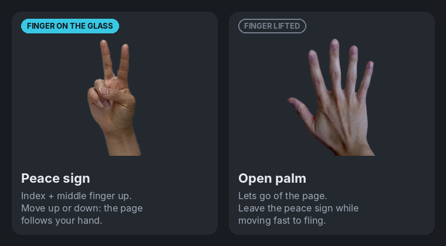
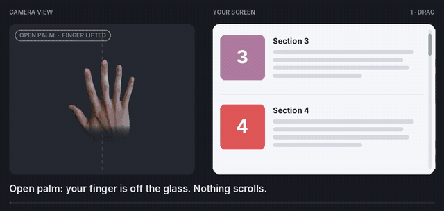
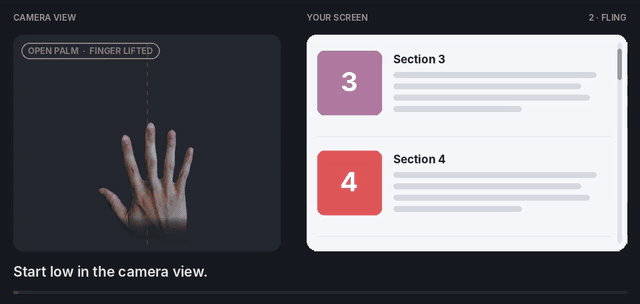
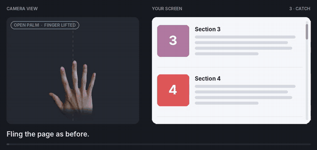
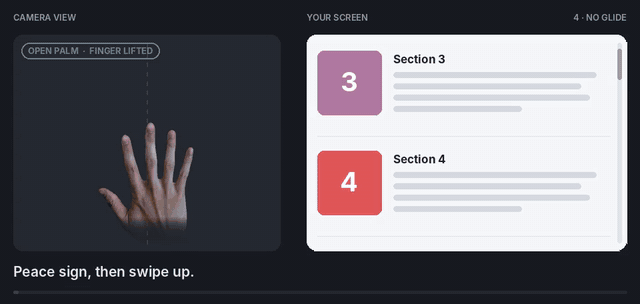
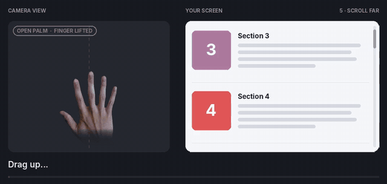
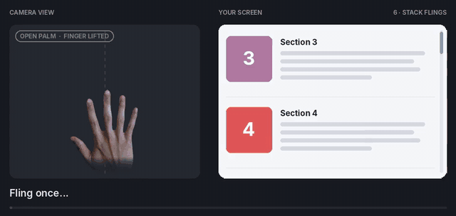
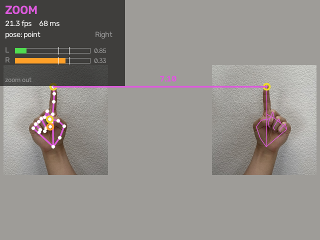

# gesture-control

Control your mouse with hand gestures from a webcam. Uses MediaPipe Hand Landmarker for
tracking and a virtual uinput device for input, so it works on Wayland (Ubuntu 26.04 GNOME).

## Run

```bash
uv run gesture-control --pointer-test   # 1. check the virtual mouse (no camera)
uv run gesture-control --calibrate      # 2. map the screen edges (once per display setup)
uv run gesture-control                  # 3. full app with preview window
```

### Calibration (absolute mode)

GNOME can spread the virtual mouse's range over an area larger than the visible screen
(fractional display scaling does this), so the cursor hits the right/bottom edge long
before your hand reaches the far side of the box. `--calibrate` slowly moves the cursor
towards each edge; press Enter the moment it touches. The result is saved to
`config/calibration.yaml`. Re-run it after changing display scaling, resolution or
monitors, and delete that file to undo it. `--pointer-test` then visits all four screen
corners so you can check the result.

### Using your mouse and gestures together (optional, one-time setup)

By default, gestures drive a virtual tablet that puts the cursor at positions the app
keeps track of itself. Wayland doesn't let apps read where the real pointer is, so after
you move your real mouse or touchpad, the next gesture makes the cursor jump back to
where gestures last left it.

The fix is the **trackball output**: the app sends movement (like a mouse) instead of
positions, so gestures continue from wherever the pointer is. GNOME would normally add
mouse acceleration on top of the app's own, which makes gestures unpredictable, so a
udev rule marks the app's device as a trackball and GNOME's trackball acceleration is set
to flat. Your real mouse and touchpad keep their own settings. Run these once:

```bash
echo 'ACTION=="add|change", SUBSYSTEM=="input", KERNEL=="event*", ATTRS{name}=="gesture-control trackball", ENV{ID_INPUT_TRACKBALL}="1"' | sudo tee /etc/udev/rules.d/99-gesture-control.rules
sudo udevadm control --reload-rules
gsettings set org.gnome.desktop.peripherals.trackball accel-profile flat
```

After that, the app uses the trackball output automatically (`cursor.relative.output:
auto`); the startup line says e.g. `cursor: relative (trackball, 1920x1080 units, auto)`.
Until then it uses the tablet and prints a one-line tip about this section. Notes:

- No calibration needed: at every start the app asks GNOME for the screen's resolution
  and scale and the mouse speed, and works out how far to move. GNOME counts trackball
  movement in logical pixels (resolution ÷ scale, e.g. 1536 × 864 for 1920 × 1080 at
  125%), multiplied by (1 + mouse speed). Changing them is picked up at the next start.
- With several monitors, the primary one is used.
- `uv run gesture-control --calibrate-trackball` measures the numbers by hand instead, in
  case the automatic ones are ever off: the cursor moves towards the right edge, then the
  top edge; press Enter the moment it touches (twice per edge: a quick pass, then a slow
  one). It shows the automatic value for comparison and saves to
  `config/calibration.yaml`, which then takes priority. To go back to automatic, delete
  the `relative:` block from that file (the app says so at startup if the saved values
  differ from GNOME's by more than 3%).
- If you own a real trackball, it also gets flat acceleration.
- To undo: `sudo rm /etc/udev/rules.d/99-gesture-control.rules`,
  `gsettings reset org.gnome.desktop.peripherals.trackball accel-profile`, and the app
  goes back to the tablet.
- Absolute mode always uses the tablet (it needs positions).

To change any behaviour, see [Configuration](#configuration).

Useful options:

| Option | What it does |
|---|---|
| `--dry-run` | Track and recognize gestures, but print actions instead of moving the mouse |
| `--mode absolute` | Hand position = screen position (the default is relative, touchpad-like) |
| `--calibrate` | Find the screen edges for absolute mode, then exit |
| `--calibrate-trackball` | Optional: measure the trackball output by hand instead of using GNOME's screen size, then exit |
| `--zoom-test` | Zoom in, then out, under the mouse pointer (a real touchpad pinch by default; no camera), then exit |
| `--start-paused` | Start paused; hold a fist ~1 s to begin |
| `--no-preview` | Run without the camera window (Ctrl+C, or `kill`, to quit) |
| `-v` | Print every action to the terminal |
| `--camera N` | Use `/dev/videoN` |
| `--config PATH` | Use another config file |

In the preview window: `q` / `Esc` quits, `p` toggles pause. The app also shuts down
cleanly (buttons and virtual fingers released, camera settings put back) when it's
stopped with Ctrl+C, `kill`, or by closing its terminal.

The app adjusts one camera setting while it runs (it stops auto-exposure from lowering
the frame rate in dim light) and puts it back when it exits, so video calls aren't
affected afterwards.

## Gestures

| Gesture | Action |
|---|---|
| Index finger up, other fingers down | Move the cursor |
| ...then pinch thumb + index | Left click; keep pinching and move to drag |
| ...pinch thumb + index twice quickly | Double click |
| ...then pinch thumb + middle (index stays up) | Right click |
| Index + middle up (peace sign), move hand up/down | Scroll, phone-style: the page follows your hand |
| ...swipe and leave the pose while still moving | Fling: the page keeps gliding, then slows down |
| ...peace sign again while it glides | Stop the glide |
| ...flick again quickly while it glides | Stack: the new fling adds the glide's speed |
| Two hands, both index fingers up: move apart / together | Zoom in / out, like a touchpad pinch |
| Open palm | Neutral: nothing happens |
| Fist held ~1 s | Pause / resume everything |

The cursor works like a touchpad (relative mode, the default): it follows your hand's
movement, not its position. Move slowly for fine control, flick to cross the screen. When
you run out of room, open your palm (the cursor stops), move your hand back, and point
again. Movement is measured in palm lengths, so it feels the same at any distance from
the camera, and tracking follows the centre of your knuckles (the big dot), which stays
put when you pinch.

Scrolling works like a phone. See [Scrolling, step by step](#scrolling-step-by-step).

In absolute mode (`--mode absolute`) your hand position maps directly to the screen:
only the rectangle drawn in the preview maps to the screen.

Both modes drive the calibrated virtual tablet by default, so run `--calibrate` once
either way. (With the [trackball output](#using-your-mouse-and-gestures-together-optional-one-time-setup),
relative mode doesn't need `--calibrate`.)

If you use both hands (one at a time), the app follows the hand that was already
moving the cursor. When it has to switch to the other hand, the cursor stays where it
is instead of jumping, and a drag in progress continues.

## Scrolling, step by step

Think of the camera view as a phone screen. The **peace sign** puts your finger on the
glass; an **open palm** lifts it off.



**Hand up, page up:** the page sticks to your fingers, so raising your hand moves the
content up and shows what's further down (the opposite of a mouse wheel).

The animations below were rendered by feeding hand movements into the app's own scroll
code, so the timing and glide match the real app. Left: the camera view. Right: the page.

### 1. Drag: slow, precise scrolling



1. Make a peace sign and hold it still for a moment (about a third of a second).
2. Move your hand up: the page moves up with it. Move down: it comes back.
3. Stop your hand and the page stops. Open your palm to let go.

### 2. Fling: cover a long distance fast



1. Start with the peace sign low in the camera view.
2. Swipe up quickly and, **while your hand is still moving**, open your palm.
3. The page carries straight on from your drag, with no pause, picks up speed (twice as
   far by default, see `fling.boost`) and slows to a stop on its own. A quicker swipe
   glides further.

### 3. Catch: stop a glide where you want



While the page glides, make the peace sign again: it stops on the spot. A click or a
fist (pause) also stops it.

### 4. Let go without a glide: scroll an exact amount



Swipe, **stop your hand** while still in the peace sign, then open your palm. Your hand
wasn't moving when you let go, so the page stays exactly where you put it.

### 5. Scroll far: when you run out of room



Drag up, open your palm and bring your hand back down (nothing scrolls back, because
your finger is off the glass), then make the peace sign and drag up again. Repeat, as
you would on a phone.

### 6. Stack flings: go faster and further



While the page glides, bring your open palm back down, then flick again: peace sign and a
quick swipe the same way. The peace sign catches the glide for a moment, and the new
fling **adds the caught speed** to your swipe, so each quick flick goes faster than the
last (up to `fling.max_notches_per_s`). This only happens if you release the new swipe
within a second of the catch and swipe the same way; a slow drag or a pause in between
gives a normal fling.

### If scrolling doesn't behave

| Problem | Fix |
|---|---|
| Nothing scrolls when I start moving | Hold the peace sign still for a moment first. The preview's top-left label must say SCROLL; if it says IDLE, keep the ring and little finger curled |
| It scrolls the wrong way for me | `scroll:` `direction: traditional` in `config/local.yaml` |
| It glides when I don't want | Stop your hand before opening your palm, raise `fling.min_speed`, or set `fling.enabled: false` |
| It never glides | Open your palm during the swipe, not after it; or lower `fling.min_speed` to `0.6` |
| Flings don't go far enough | Raise `fling.boost` (default 2.0), e.g. `3.0`. Drags are unaffected. Or flick repeatedly (lesson 6) |
| Repeated flicks don't speed up | Flick sooner after the catch (within `fling.stack.window_s`, 1 s) and the same way as the glide |
| Repeated flicks get too fast | Lower `fling.stack.factor` (e.g. `0.5`) or `fling.max_notches_per_s` |
| Glide lasts too long / too short | `fling.time_constant_s: 0.3` (stops sooner) or `0.7` (glides longer) |

## Zoom: two-hand pinch

Hold up both hands with the index fingers pointing (other fingers curled), like two
fingertips on a touchpad. Move your hands **apart to zoom in** and **together to zoom
out**. The preview turns magenta, shows ZOOM, and draws a line between your fingertips
with the current spread.



By default the app performs a **true touchpad pinch**: it creates a virtual touchpad
and moves two virtual fingers on it apart or together with your hands. GNOME sees a real
two-finger pinch, so apps zoom smoothly and centred on the mouse pointer, exactly as with
a laptop touchpad.

- **Point at what you want to zoom.** The zoom centres on the mouse pointer.
- **Apps with pinch support:** Firefox, Chromium-based browsers running on Wayland,
  GNOME apps such as Image Viewer (Loupe), Document Viewer (Papers) and Maps. Apps
  without pinch support (LibreOffice, many older apps) ignore it; for those, see
  `ctrl_scroll` below.
- **Hands spread 1.5x = fingers spread 1.5x**, and the app zooms by that ratio. If you
  spread or close your hands a lot, the virtual fingers lift and land again in the
  middle of the touchpad (a re-grip, as on a real touchpad), so you can keep going.
- **The touchpad must be turned on** in Settings > Mouse & Touchpad. GNOME's touchpad
  settings apply to the virtual touchpad too. If the touchpad is off, or set to turn off
  while a mouse is connected (this app's virtual pointer counts as a mouse), the app
  says so at startup and in the preview, and doesn't zoom. It doesn't switch to Ctrl +
  wheel on its own. With the turn-off-with-a-mouse setting, your **laptop's own
  touchpad** also stops working while the app runs; the app warns about that at startup
  whatever zoom method you use.
- `zoom.invert: true` swaps the directions (apart = zoom out) for every method.
- While you're dragging (left pinch held), a second pointing hand doesn't start a zoom,
  so the drag isn't cut short.
- Clicks, cursor movement and scrolling pause while both hands point. The virtual
  fingers are lifted as soon as a hand drops, leaves the view, or the app stops.
- Keep a little space between your hands: if they touch, the tracker may see them as one
  hand and the zoom ends.

**Check it works without the camera:** run `uv run gesture-control --zoom-test` and, within
3 seconds, put the mouse pointer over a page in Firefox or an image in Image Viewer. It
pinches out (zoom in), then in (zoom out). To see what GNOME receives, run
`sudo libinput debug-events` in a second terminal first: a working pinch prints
`GESTURE_PINCH_BEGIN`, `GESTURE_PINCH_UPDATE` and `GESTURE_PINCH_END` lines from the
device "gesture-control touchpad".

### Ctrl + scroll instead (opt-in)

To zoom with Ctrl + mouse wheel, which works in more apps (including LibreOffice and
most editors) but in steps rather than smoothly, set this in `config/local.yaml`:

```yaml
zoom:
  method: ctrl_scroll   # or: keys (Ctrl+= / Ctrl+-, for apps without Ctrl+wheel zoom)
```

With these methods, spreading your hands 15% further is one zoom step
(`zoom.notch_ratio`), and the touchpad settings don't matter.

With one hand in view, the app looks for a second hand only every 5th frame to keep
tracking fast, so a zoom can take about 0.2 seconds to start.

| Problem | Fix |
|---|---|
| Startup says zoom is off | Turn the touchpad on in Settings > Mouse & Touchpad, or allow it while a mouse is connected: `gsettings set org.gnome.desktop.peripherals.touchpad send-events enabled` |
| `--zoom-test` does nothing | Is the pointer over a pinch-capable app? Run `sudo libinput debug-events` during the test: no `GESTURE_PINCH` lines means GNOME isn't accepting the virtual touchpad; tell me what it prints |
| Preview shows ZOOM but the app doesn't zoom | The app has no pinch support: use `zoom.method: ctrl_scroll`. In `sudo libinput debug-events`, `POINTER_SCROLL_FINGER` lines instead of `GESTURE_PINCH` mean libinput took the pinch for a scroll: tell me |
| Preview never shows ZOOM | Both index fingers must be up and the other fingers curled on both hands; keep both hands fully in view |
| Zooms too slowly / too fast | Touchpad: `zoom.touchpad.gain: 1.5` / `0.7`. Ctrl + scroll: lower / raise `zoom.notch_ratio` |
| A right-click menu appears when zooming starts | Tap-to-click turned a brief two-finger touch into a right click; tell me, this shouldn't happen (fingers stay down at least 0.25 s) |
| Zoom starts too slowly | `tracker:` `second_hand_check_every: 2` (uses more CPU with one hand) |
| Don't need zoom | `zoom:` `enabled: false` and `tracker:` `num_hands: 1` |

## Configuration

### How the config files work

Settings are read from up to four layers. Each layer only needs the settings it changes,
and later layers win:

| Order | Source | Who writes it |
|---|---|---|
| 1 | Built-in defaults (`src/gesture_control/config.py`) | the code |
| 2 | `config/gestures.yaml` | each build (overwritten by `unzip -o`) |
| 3 | `config/calibration.yaml` | `--calibrate` |
| 4 | `config/local.yaml` | **you** |

Put your changes in **`config/local.yaml`**. It's never included in a build, so updates
can't overwrite it. Use `gestures.yaml` as a reference for names and defaults, but don't
edit it: the next build replaces it.

Settings are read once at startup. After editing, quit the app (`q`) and start it again.

### Writing local.yaml

Create the file with any text editor (`nano config/local.yaml`, or `gnome-text-editor`)
and copy in only the settings you want to change, keeping the section names above them:

```yaml
# config/local.yaml - my overrides
pinch:
  start: 0.32            # pinches register a little earlier

cursor:
  relative:
    gain_slow: 0.03      # finer aiming
    gain_fast: 0.5       # cross the screen with less arm movement

double_click:
  window_ms: 900
```

YAML rules that matter here:

- Indent with **2 spaces per level, never tabs**. Indentation is what puts a setting
  inside a section: `start` belongs to `pinch` because it is indented under it.
- Write each setting as `name: value`, with a space after the colon.
- Text after `#` is a comment.
- Values: numbers (`0.32`, `700`), `true` / `false`, words (`relative`), and lists in
  square brackets (`[0.63, 0.58]`).
- Only include the settings you change; everything else keeps its default.

If something is wrong, the app tells you at startup:

```
Config error: local.yaml (line 3, column 11): mapping values are not allowed here. ...
Config warning: local.yaml: unknown setting 'pinch.strat' (typo?) - ignored
Config error: pinch.release (0.3) must be larger than pinch.start (0.4); otherwise a resting thumb clicks over and over
```

Values that would make the app misbehave (not just feel different) are refused this way:
negative or zero speeds and gains, `pinch.release` not above `pinch.start`,
`pose.extend_ratio` not above `curl_ratio`, frame counts below 1, and a cursor region
outside 0..1.

When `config/local.yaml` loads, the startup line `Also loaded: config/local.yaml`
confirms it. `uv run gesture-control --dry-run` is a safe way to try changes: everything
works except that clicks and movement are printed instead of performed.

To reset a setting, delete it from `local.yaml`. To reset everything, delete the file.
To undo calibration, delete `config/calibration.yaml`.

### Common changes

| I want to... | Setting in local.yaml |
|---|---|
| Aim more precisely | `cursor:` `relative:` `gain_slow: 0.03` |
| Cross the screen with less arm movement | `cursor:` `relative:` `gain_fast: 0.6` |
| Stop the cursor creeping while my hand is still | `cursor:` `relative:` `min_speed: 0.25` |
| Make pinches register more easily | `pinch:` `start: 0.33` and `release: 0.47` |
| Stop false clicks | `pinch:` `start: 0.24` |
| Allow pinches with my hand more turned | `pinch:` `min_facing: 0.5` |
| Get double clicks more easily | `double_click:` `window_ms: 900` |
| Scroll faster | `scroll:` `notches_per_height: 40` |
| Scroll like a mouse wheel instead of a phone | `scroll:` `direction: traditional` |
| Fling further (drags unchanged) | `scroll:` `fling:` `boost: 3.0` |
| Repeated flicks speed up less / not at all | `scroll:` `fling:` `stack:` `factor: 0.5` / `enabled: false` |
| Longer / shorter glide after a fling | `scroll:` `fling:` `time_constant_s: 0.7` / `0.3` |
| Turn the glide off | `scroll:` `fling:` `enabled: false` |
| Pause/resume with a shorter fist hold | `pause:` `fist_hold_s: 0.7` |
| Use hand position = screen position | `cursor:` `mode: absolute` |
| Zoom faster / slower with two hands | `zoom:` `touchpad:` `gain: 1.5` / `0.7` |
| Zoom with Ctrl + wheel instead of a touchpad pinch | `zoom:` `method: ctrl_scroll` |
| Zoom with Ctrl+= / Ctrl+− | `zoom:` `method: keys` |
| Use a different camera | `camera:` `index: 2` |

### All settings

Distances like `pinch.start` are relative to your palm size (wrist to middle knuckle,
about 9 cm), so they don't change with distance from the camera.

#### `camera`

| Setting | Default | What it does |
|---|---|---|
| `index` | `0` | Camera device number: `0` = `/dev/video0` (`--camera N` overrides it) |
| `width`, `height` | `640`, `480` | Capture resolution. Higher doesn't improve tracking, it only costs speed |
| `fps` | `30` | Requested frame rate (your webcam's maximum is 30) |
| `fourcc` | `MJPG` | Camera format. `MJPG` gives full frame rate; `YUYV` is the uncompressed alternative |
| `mirror` | `true` | Mirror the image so moving your hand right moves the cursor right |
| `lock_framerate` | `true` | Stop auto-exposure lowering the frame rate in dim light |

#### `tracker` (MediaPipe hand tracking)

| Setting | Default | What it does |
|---|---|---|
| `model` | `models/hand_landmarker.task` | Model file, relative to the project folder |
| `num_hands` | `2` | Hands to track. 2 is needed for two-hand zoom; one-hand gestures follow the hand you were already using. Set 1 if you don't use zoom |
| `second_hand_check_every` | `5` | With one hand in view, look for a second hand only every N frames (finding one switches to full two-hand tracking). Looking every frame (1) roughly doubles the CPU time per frame |
| `min_detection_confidence` | `0.6` | How sure the model must be to find a new hand. Lower finds hands sooner, but with more false detections |
| `min_presence_confidence` | `0.6` | How sure it must be that the hand is still there |
| `min_tracking_confidence` | `0.5` | Below this it searches for the hand again instead of tracking it |

#### `pose` (finger up / curled detection)

| Setting | Default | What it does |
|---|---|---|
| `extend_ratio` | `1.15` | A finger is up when its tip is this many times further from the wrist than its middle joint (typical: up 1.3–1.5) |
| `curl_ratio` | `0.95` | A finger is curled below this (typical: 0.6–0.8). Used for the fist |
| `debounce_frames` | `3` | Frames a pose must hold before it counts (3 = about 100 ms). Higher = fewer accidental mode changes, but slower to react |

#### `pinch` (clicks)

| Setting | Default | What it does |
|---|---|---|
| `start` | `0.28` | A pinch begins when the thumb–fingertip distance drops below this (left tick on the L / R bars). Higher = registers more easily |
| `release` | `0.42` | It ends when the distance rises above this (right tick). Must be larger than `start` |
| `confirm_frames` | `3` | Frames below `start` before the click fires. Higher = fewer accidental clicks, slightly slower |
| `min_finger_reach` | `1.05` | Left pinch only counts if the index fingertip is at least this far from the wrist, so a fist isn't read as a click |
| `right_min_reach` | `0.0` | Same check for the middle finger and right click. `0` = off |
| `min_facing` | `0.6` | Pinches only start when your hand faces the camera at least this squarely (1 = square on, 0 = edge-on) |

#### `cursor`

| Setting | Default | What it does |
|---|---|---|
| `mode` | `relative` | `relative`: touchpad-like, the cursor follows hand movement. `absolute`: hand position = screen position |
| `anchor` | `knuckles` | Hand point that drives the cursor: `knuckles` (average of 4, steadiest), `index_mcp` (index knuckle), `index_tip` (fingertip, moves when you pinch), `palm_center` |
| `click_freeze_ms` | `180` | After a click starts, hold the cursor still this long so the click lands on target |
| `abs_scale` | `[1.0, 1.0]` | Written by `--calibrate` (into `calibration.yaml`); don't set it by hand |

`cursor.relative` (relative mode). Gain is screen widths of cursor travel per palm length
of hand travel. It rises smoothly from `gain_slow` to `gain_fast` as hand speed rises
from `speed_slow` to `speed_fast`:

| Setting | Default | What it does |
|---|---|---|
| `gain_slow` | `0.05` | Gain for slow movement (0.05 = 96 px per palm length on a 1920 px screen). Lower = more precise |
| `gain_fast` | `0.4` | Gain for fast movement. Higher = less arm movement to cross the screen |
| `speed_slow` | `0.6` | Hand speed (palm lengths per second) at or below which `gain_slow` applies |
| `speed_fast` | `5.0` | Hand speed at or above which `gain_fast` applies |
| `min_speed` | `0.15` | Slower than this counts as holding still: hides tracking jitter. Raise it if the cursor creeps |
| `screen_aspect` | `auto` | Screen width ÷ height, so vertical and horizontal movement match. `auto` reads it from GNOME (1.6 if it can't); or set a number: 1.6 for 16:10, 1.78 for 16:9. The trackball output always uses the screen's real shape |
| `output` | `auto` | `auto`: the trackball output once its [one-time setup](#using-your-mouse-and-gestures-together-optional-one-time-setup) is done, otherwise the tablet. `trackball`: always (exits with the setup steps if they're missing). `tablet`: the calibrated virtual tablet; the cursor jumps back after you use your real mouse. `mouse`: plain mouse events, with GNOME's mouse acceleration added on top |
| `trackball_counts` | `[0, 0]` | Movement units for one screen width and height. `[0, 0]` = automatic (from GNOME); `--calibrate-trackball` writes measured values |
| `trackball_mouse_speed` | `null` | Written by `--calibrate-trackball`: GNOME's mouse speed at calibration, to warn when it changes |
| `mouse_px_per_screen` | `1920` | Only for `output: mouse`: movement units per screen width (the height uses `screen_aspect`) |
| `filter.min_cutoff` | `1.0` | Smoothing when still. Lower = steadier, but more lag |
| `filter.beta` | `4.0` | Smoothing when moving. Higher = less lag on fast moves, but more jitter |
| `filter.d_cutoff` | `1.0` | Smoothing of the speed estimate; rarely needs changing |

Absolute mode only:

| Setting | Default | What it does |
|---|---|---|
| `region.x_min`, `x_max` | `0.2`, `0.8` | Left and right edges of the box (fractions of the camera image) that maps to the screen |
| `region.y_min`, `y_max` | `0.2`, `0.7` | Top and bottom edges of that box |
| `filter.min_cutoff` / `beta` / `d_cutoff` | `1.0` / `10.0` / `1.0` | Smoothing, as above |
| `deadzone` | `0.0015` | Ignore cursor changes smaller than this fraction of the screen |

#### `scroll` (peace sign)

| Setting | Default | What it does |
|---|---|---|
| `notches_per_height` | `25` | Wheel notches for moving your hand the full camera-image height. Higher = faster scrolling |
| `direction` | `natural` | `natural`: the page follows your hand, like a phone. `traditional`: like a mouse wheel (hand up = scroll up). Replaces the old `invert` setting |
| `deadzone` | `0.0015` | Ignore vertical movement smaller than this per frame |
| `settle_ms` | `200` | Ignore movement just after switching to the scroll pose |
| `fling.enabled` | `true` | Keep gliding after a fast swipe ends |
| `fling.min_speed` | `0.8` | Hand speed when leaving the pose (camera-image heights per second) needed for a glide. Lower = glides more easily |
| `fling.boost` | `2.0` | The glide goes this many times further than at plain swipe speed. Higher = flings go further, with the glide lasting only slightly longer. Doesn't affect dragging. `1.0` = glide at exactly your swipe speed |
| `fling.boost_ramp_s` | `0.15` | The glide starts at exactly your drag speed, with no pause, and eases up to the boosted speed over about this long, so drag and glide feel like one motion. Raise it if the speed-up after letting go feels abrupt |
| `fling.max_notches_per_s` | `300` | Speed limit for any glide, stacked or not |
| `fling.stack.enabled` | `true` | A quick flick during a glide adds the glide's speed to the new fling |
| `fling.stack.window_s` | `1.0` | The new swipe must be released within this long after the peace sign catches the glide |
| `fling.stack.factor` | `1.0` | Share of the caught glide speed carried into the new fling (`0.5` = half) |
| `fling.stack.settle_ms` | `60` | Settle time right after catching a glide, shorter than `settle_ms` so a quick flick isn't lost |
| `fling.time_constant_s` | `0.45` | How long the glide lasts. Higher = glides longer and further |
| `filter.*` | `1.0` / `5.0` / `1.0` | Smoothing, as above |

#### `zoom` (two hands)

| Setting | Default | What it does |
|---|---|---|
| `enabled` | `true` | Two pointing hands zoom. Needs `tracker.num_hands: 2` |
| `method` | `touchpad` | `touchpad`: a true two-finger pinch on a virtual touchpad (smooth, centred on the pointer; needs the touchpad turned on and an app with pinch support). `ctrl_scroll`: Ctrl + smooth mouse wheel (works in more apps, in steps). `keys`: Ctrl+= / Ctrl+− taps |
| `touchpad.gain` | `1.0` | Finger spread = hand spread ^ gain. Higher = zooms faster |
| `touchpad.start_mm` | `45` | Distance between the virtual fingers when a pinch starts. The fingers sit on a diagonal, like a thumb and index finger |
| `touchpad.width_mm`, `height_mm` | `100`, `65` | Size of the virtual touchpad. The fingers stay inside the zones where libinput ignores palms (outer 8% of the width) and thumbs (bottom 15%) |
| `notch_ratio` | `1.15` | `ctrl_scroll` / `keys`: spreading your hands this many times further = one zoom step. Lower = zooms faster |
| `invert` | `false` | `true` = spread to zoom out |
| `settle_ms` | `150` | Ignore movement just after both hands start pointing |
| `deadzone` | `0.004` | Ignore tiny spread changes (log scale), so still hands don't drift the zoom |
| `ctrl_release_ms` | `400` | `ctrl_scroll`: let go of Ctrl after the hands have been still this long |
| `filter.*` | `1.0` / `2.0` / `1.0` | Smoothing of the spread, as for the cursor |

#### `double_click`

| Setting | Default | What it does |
|---|---|---|
| `enabled` | `true` | Two quick pinches = double click |
| `window_ms` | `700` | The second pinch must start within this time of releasing the first |
| `max_move` | `0.02` | The cursor may drift at most this far between pinches (fraction of screen width, 0.02 = about 38 px) |
| `os_time_ms` | `auto` | The system double-click time. `auto` reads GNOME's setting (400 ms by default); or set a number |

#### `pause`, `safety`, `preview`

| Setting | Default | What it does |
|---|---|---|
| `pause.fist_hold_s` | `1.0` | Seconds to hold a fist to pause or resume |
| `pause.start_paused` | `false` | Start paused (same as `--start-paused`) |
| `safety.lost_hand_release_frames` | `8` | Release a held button (e.g. mid-drag) if the hand is lost for this many frames |
| `preview.enabled` | `true` | Show the camera window (`--no-preview` turns it off) |
| `preview.window_name` | `gesture-control` | Window title |
| `preview.show_landmarks` | `true` | Draw the hand skeleton |

## Tuning

The preview shows live values that help you choose settings:

- **L / R bars**: thumb–index and thumb–middle pinch distances. The white ticks are
  `pinch.start` and `pinch.release`. If clicks don't register, raise `start`; if they
  fire on their own, lower it.
- **facing**: how squarely your hand faces the camera (1 = square on, 0 = edge-on).
  New pinches only start above `pinch.min_facing` (0.6); below it the bars turn grey,
  because a turned hand makes fingertips line up and look touching when they aren't.
  If real pinches get blocked, lower it a little; if false clicks still happen, raise it.
- **Pinch arming**: a pinch only counts after the bar has been seen open (past the
  right tick) while your hand faces the camera, then closes. The L / R label turns green
  when armed. If a bar goes red but nothing clicks, check that its label was green first:
  open the fingers a little wider before tapping.
- **Double click** (`double_click`): the second pinch must start within `window_ms`
  (700) of letting go of the first, with the cursor within `max_move` of the first click.
  It then snaps back to the first click's spot, so a little drift doesn't matter.
  If double clicks come out as two single clicks, raise `window_ms`.
- **pose (raw)**: the debounced pose, with the raw per-frame pose in brackets when they differ.
- **fps / ms**: processing rate and camera-to-action latency.
- Relative mode feel (`cursor.relative`): too twitchy for precise aiming, lower
  `gain_slow`; too much arm movement to cross the screen, raise `gain_fast`. Cursor
  creeps while your hand is still, raise `min_speed`.
- Absolute mode: too jittery when still, lower `cursor.filter.min_cutoff`; laggy on fast
  moves, raise `cursor.filter.beta`.

## Layout

```
docs/scroll/                  scrolling pictures and animations (README)
docs/zoom/                    zoom picture (README)
config/gestures.yaml          settings (overwritten by new builds)
config/local.yaml             your overrides (optional, never overwritten)
config/calibration.yaml       written by --calibrate and --calibrate-trackball
src/gesture_control/
  app.py          main loop and CLI
  calibrate.py    screen-edge calibration (--calibrate)
  trackball.py    trackball output setup checks and --calibrate-trackball
  display.py      screen size and scale from GNOME (D-Bus)
  touchpad.py     virtual touchpad for the two-hand pinch
  capture.py      threaded camera reader (newest frame only)
  tracker.py      MediaPipe Hand Landmarker wrapper
  features.py     finger states, pinch distances, pose classification
  filters.py      One Euro filter
  controller.py   gesture state machine (modes, debounce, pinch, pause)
  pointer.py      uinput virtual mouse
  overlay.py      preview window drawing
```
